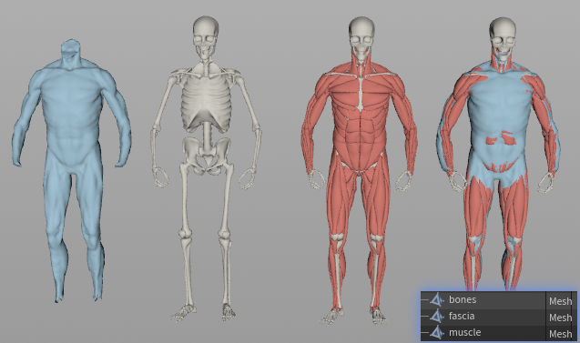

# A GPU XPBD Physics Engine for Muscle-Skeletal Character Animation

It is also the code for paper **"RLMuscle: Physics-Based Muscle-Driven Character Animation via Reinforcement Learning"**

Based on NVIDIA Warp, which is capable for **all platforms (Windows, Linux, MacOS)** and **GPU as well as CPU** parallelization.

## ✨ Features

- 🚀 **Fast & cheap** — 18 ms/frame, 98 MB GPU memory for a 172k-vert human muscle sim on a 4090.
- 🌍 **Runs anywhere** — built on NVIDIA Warp: CPU **and** GPU, on Windows, Linux & macOS.
- 💥 **Collision handling** — per-vertex SDF push-out today; DCD & CCD on the way.
- 🫀 **Tissue + fascia** — one tetrahedral mesh; the fascia shell prevents splaying and reduces penetration.
- 📦 **Flexible export** — USD (default & recommended), PLY, and Houdini `.geo` (round-trips with all attributes intact).

## Examples

All examples default to writing a **single USD file with animation** under `output/`.
Run from the repo root with `PYTHONPATH=src` (commands below already include it).

### ⭐ Core demo — humanV2 muscle 

<p align="center">
  <a href="src/muscle/collision/sdf/example/humanV2_fascia.py">
    
  </a>
</p>

Human muscle with the **tissue-fascia** and animated-bone SDF **collision**. Runs 10 substeps XPBD per frame, only costs **18ms/frame** **98MB GPU memory on a 4090**. 

Fascia is an auxiliary mesh to prevent muscle splaying and reduce penetration. We integrate fascia and tissue into one tetrahedral mesh, where fascia is its surface triangle mesh. Fascia should be deleted in the final render, but is useful for simulation. 

```bash
PYTHONPATH=src python -m muscle.collision.sdf.example.humanV2_fascia --end_frame 50
# → output/humanV2_fascia_coll.usd
```

<table>
  <tr><th colspan="2">Performance — 50 frames, RTX 4090</th></tr>
  <tr><td>
  </td></tr>substeps</td><td>10,</td></tr>
  </td></tr>dt</td></tr> 1/24 s</td></tr>
  <tr><td>verts</td><td>172,717 (muscle 157,369 + fascia 15,348)</td></tr>
  <tr><td>tets</td><td>534,947 (muscle 468,162 + fascia 66,785)</td></tr>
  <tr><td>sim (<code>no export</code>)</td><td>0.9 s — 18 ms/frame</td></tr>
  <tr><td>sim with USD export</td><td>1.6 s — 32 ms/frame</td></tr>
  <tr><td>first run (cold, builds <code>.npy</code> cache)</td><td>37.5 s — per-frame cost is JSON <code>.geo</code> parsing, cached after</td></tr>
  <tr><td>peak GPU memory</td><td>~98 MiB (w/o CUDA/Warp context, which is ~386 MiB)</td></tr>
  <tr><td>max penetration</td><td>0.0 mm (resolved each frame)</td></tr>
</table>

> Per-frame bone/cons targets are Houdini `.geo` (large JSON). They are parsed
> once and cached as binary `.npy` (`geo_io.read_geo_attr_cached`); warm runs
> load the cache, making the GPU solve (~18 ms/frame) the bottleneck.

<table>
  <tr>
    <td colspan="3"><h3>Muscle / One-Way Coupling</h3></td>
  </tr>
  <tr>
    <td colspan="3">
      ARAP-HPBD muscle pinned one-way to a target pose, <b>no collision handling</b>.
      <code>bicep</code> runs on <code>MuscleSim</code>; the creature cases run on
      <code>OneWaySim</code> — both on the shared <code>XpbdEngine</code>. Compare the
      <code>humanV2</code> case here against the collision-handling version in the SDF
      section below.
    </td>
  </tr>
  <tr>
    <td align="center" width="33%"><br><b>humanV2 muscle vs animated bone (No collision handling)</b></td>
    <td align="center" width="33%"><br><b>bicep (one-way)</b></td>
    <td align="center" width="33%"><br><b>lion (one-way)</b></td>
  </tr>
  <tr>
    <td align="center" width="33%"><code>PYTHONPATH=src python -m muscle.coupleOneWayGmg.example --config data/humanV2/config/humanV2_gmg.json --out output/humanv2_oneway.usd</code></td>
    <td align="center" width="33%"><code>PYTHONPATH=src python -m muscle.example --auto</code></td>
    <td align="center" width="33%"><code>PYTHONPATH=src python -m muscle.coupleOneWayGmg.example --config data/lion/config/lion_nomg.json --out output/lion_oneway.usd</code></td>
  </tr>
  <tr>
    <td align="center" width="33%"><sub>→ <code>output/humanv2_oneway.usd</code></sub></td>
    <td align="center" width="33%"><sub>→ <code>output/bicep_oneway.usd</code></sub></td>
    <td align="center" width="33%"><sub>→ <code>output/lion_oneway.usd</code></sub></td>
  </tr>
  <tr>
    <td align="center" width="33%"><br><b>minotaur (one-way)</b></td>
    <td align="center" width="33%"><br><b>minotaur leg (one-way)</b></td>
    <td align="center" width="33%"></td>
  </tr>
  <tr>
    <td align="center" width="33%"><code>PYTHONPATH=src python -m muscle.coupleOneWayGmg.example --config data/minotaur/config/minotaur.json --out output/minotaur_oneway.usd</code></td>
    <td align="center" width="33%"><code>PYTHONPATH=src python -m muscle.coupleOneWayGmg.example --config data/minotaur_leg/config/minotaur_leg.json --out output/minotaur_leg_oneway.usd</code></td>
    <td align="center" width="33%"></td>
  </tr>
  <tr>
    <td align="center" width="33%"><sub>→ <code>output/minotaur_oneway.usd</code></sub></td>
    <td align="center" width="33%"><sub>→ <code>output/minotaur_leg_oneway.usd</code></sub></td>
    <td align="center" width="33%"></td>
  </tr>
</table>

<table>
  <tr>
    <td colspan="3"><h3>SDF Collision</h3></td>
  </tr>
  <tr>
    <td colspan="3">
      Per-vertex analytic / mesh SDF push-out. Simple, fast, stable — but
      <b>no self-intersection handling</b> and contacts are not perfectly erased.
    </td>
  </tr>
  <tr>
    <td align="center" width="33%">
      <a href="src/muscle/collision/sdf/example/u_drop.py">
        
      </a><br><b>U drop (soft vs plane)</b>
    </td>
    <td align="center" width="33%">
      <a href="src/muscle/collision/sdf/example/rigid_soft.py">
        
      </a><br><b>Rigid sphere vs soft body</b>
    </td>
    <td align="center" width="33%">
      <a href="src/muscle/collision/sdf/example/humanV2.py">
        
      </a><br><b>humanV2 muscle vs animated bone (Collision handling)</b>
    </td>
  </tr>
  <tr>
    <td align="center" width="33%">
      <code>PYTHONPATH=src python -m muscle.collision.sdf.example.u_drop --config data/collisionTest/sdf_drop.json --shape plane</code>
    </td>
    <td align="center" width="33%">
      <code>PYTHONPATH=src python -m muscle.collision.sdf.example.rigid_soft --config data/collisionTest/rigid_soft.json</code>
    </td>
    <td align="center" width="33%">
      <code>PYTHONPATH=src python -m muscle.collision.sdf.example.humanV2 --config data/humanV2/config/humanV2_gmg.json --bone_dir data/humanV2/model/bone --end_frame 20</code>
    </td>
  </tr>
  <tr>
    <td align="center" width="33%"><sub>→ <code>output/sdf_drop.usd</code></sub></td>
    <td align="center" width="33%"><sub>→ <code>output/rigid_soft.usd</code></sub></td>
    <td align="center" width="33%"><sub>→ <code>output/humanV2_sdf_coll.usd</code></sub></td>
  </tr>
  <tr>
    <td colspan="3"><h3>DCD Collision</h3></td>
  </tr>
  <tr>
    <td colspan="3">
      Faithful Warp port of Gaia_UDCF triangle-triangle discrete collision —
      <b>handles self-collision</b> (U arms fold and press without crossing).
      Material is Gaia's MassSpring (XPBD springs + hard volume + inversion).
      DCD cannot perfectly erase contacts either, which requiring CCD. But most penatrations are shallow.
      The U-drop runs on the shared <code>XpbdEngine</code> (<code>MassSpringSim</code>) —
      the same substep-program engine as <code>MuscleSim</code> and <code>OneWaySim</code>.
    </td>
  </tr>
  <tr>
    <td align="center" width="33%">
      <a href="src/muscle/collision/udcf/example/u_drop.py">
        
      </a><br><b>U drop (self-collision)</b>
    </td>
    <td align="center" width="33%"></td>
    <td align="center" width="33%"></td>
  </tr>
  <tr>
    <td align="center" width="33%">
      <code>PYTHONPATH=src python -m muscle.collision.udcf.example.u_drop --steps 60 --init_vel_y 0</code>
    </td>
    <td align="center" width="33%"></td>
    <td align="center" width="33%"></td>
  </tr>
  <tr>
    <td align="center" width="33%"><sub>→ <code>output/udcf_u_drop.usd</code></sub></td>
    <td align="center" width="33%"></td>
    <td align="center" width="33%"></td>
  </tr>
</table>


## Art assets

Large `model/` geometry is not in git — it lives in the private HF dataset
[`chunleili/rlmuscleV2-assets`](https://huggingface.co/datasets/chunleili/rlmuscleV2-assets)
as `<case>/model.zip`, extracting to `data/<case>/model/`.

```bash
pip install huggingface_hub
hf auth login                  # read token; ask owner for repo access (private)
python tools/fetch_assets.py   # download all cases (or pass case names)
```

Upload (maintainer): `hf upload chunleili/rlmuscleV2-assets data/<case>/model.zip <case>/model.zip --repo-type dataset`
