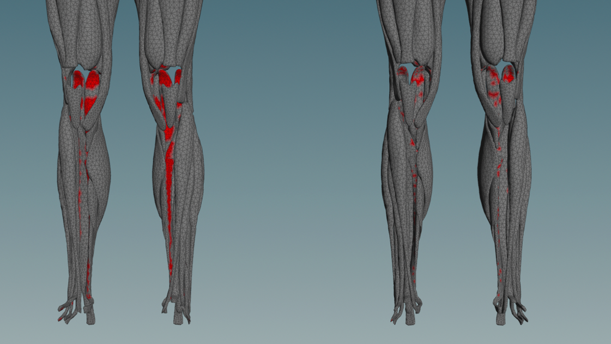
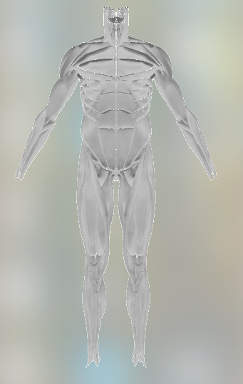
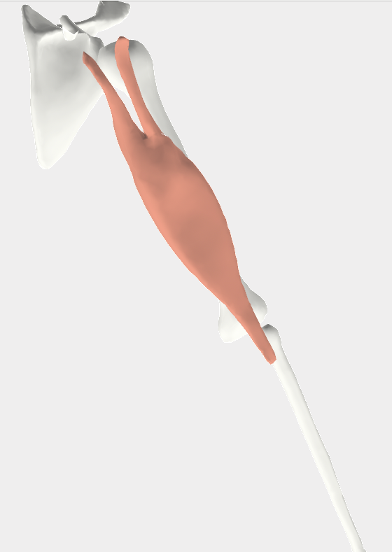
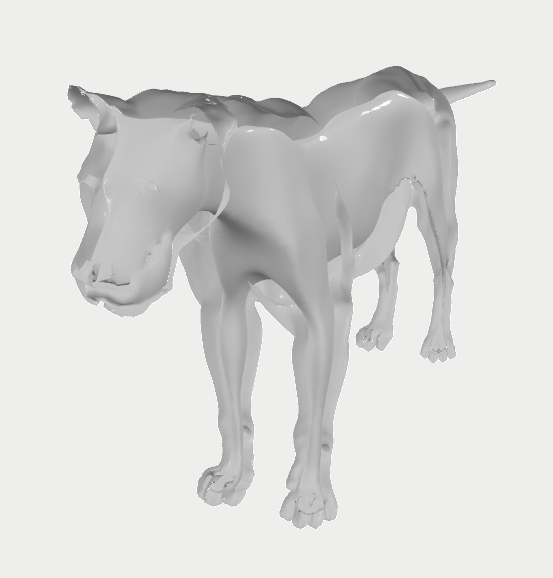
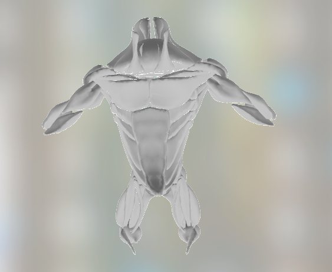
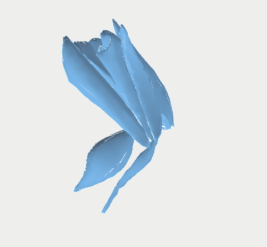
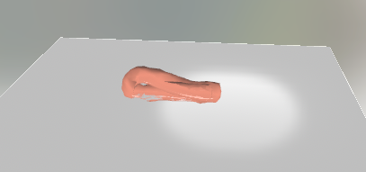
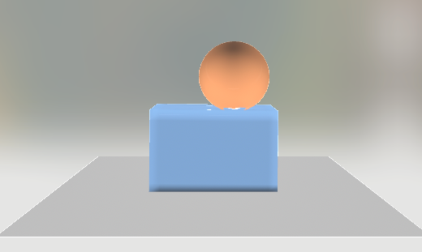
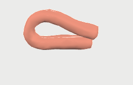

# A Warp-Based XPBD Physics Engine for Muscle-Skeletal Character Animation


It is also the code for "RLMuscle: Physics-Based Muscle-Driven Character Animation via Reinforcement Learning"

## Examples

All examples default to writing a **USD mesh sequence** under `output/`.
Run from the repo root with `PYTHONPATH=src` (commands below already include it).

### ⭐ Core demo — humanV2 muscle vs animated bone (SDF collision handling)

<p align="center">
  <a href="src/muscle/collision/sdf/example/humanV2.py">
    
  </a>
</p>

Muscles driven by an animated skeleton, with per-vertex SDF collision pushing
muscle off bone every substep. This is the flagship scenario; the one-way
`humanV2` below is the same scene **without** collision handling, for comparison.

```bash
PYTHONPATH=src python -m muscle.collision.sdf.example.humanV2 \
    --config data/humanV2/config/humanV2_gmg.json \
    --bone_dir data/humanV2/model/bone --end_frame 20
# → output/humanV2_sdf_coll.usd
```

<table>
  <tr>
    <td colspan="3"><h3>Muscle / One-Way Coupling</h3></td>
  </tr>
  <tr>
    <td colspan="3">
      ARAP-HPBD muscle pinned one-way to a target pose, <b>no collision handling</b>.
      <code>bicep</code> runs on <code>MuscleSim</code>; the creature cases run on
      <code>OneWaySim</code> — both on the shared <code>XpbdEngine</code>. Compare the
      <code>humanV2</code> case here against the collision-handling version in the SDF
      section below.
    </td>
  </tr>
  <tr>
    <td align="center" width="33%"><br><b>humanV2 muscle vs animated bone (No collision handling)</b></td>
    <td align="center" width="33%"><br><b>bicep (one-way)</b></td>
    <td align="center" width="33%"><br><b>lion (one-way)</b></td>
  </tr>
  <tr>
    <td align="center" width="33%"><code>PYTHONPATH=src python -m muscle.coupleOneWayGmg.example --config data/humanV2/config/humanV2_gmg.json --out output/humanv2_oneway.usd</code></td>
    <td align="center" width="33%"><code>PYTHONPATH=src python -m muscle.example --auto</code></td>
    <td align="center" width="33%"><code>PYTHONPATH=src python -m muscle.coupleOneWayGmg.example --config data/lion/config/lion_nomg.json --out output/lion_oneway.usd</code></td>
  </tr>
  <tr>
    <td align="center" width="33%"><sub>→ <code>output/humanv2_oneway.usd</code></sub></td>
    <td align="center" width="33%"><sub>→ <code>output/bicep_oneway.usd</code></sub></td>
    <td align="center" width="33%"><sub>→ <code>output/lion_oneway.usd</code></sub></td>
  </tr>
  <tr>
    <td align="center" width="33%"><br><b>minotaur (one-way)</b></td>
    <td align="center" width="33%"><br><b>minotaur leg (one-way)</b></td>
    <td align="center" width="33%"></td>
  </tr>
  <tr>
    <td align="center" width="33%"><code>PYTHONPATH=src python -m muscle.coupleOneWayGmg.example --config data/minotaur/config/minotaur.json --out output/minotaur_oneway.usd</code></td>
    <td align="center" width="33%"><code>PYTHONPATH=src python -m muscle.coupleOneWayGmg.example --config data/minotaur_leg/config/minotaur_leg.json --out output/minotaur_leg_oneway.usd</code></td>
    <td align="center" width="33%"></td>
  </tr>
  <tr>
    <td align="center" width="33%"><sub>→ <code>output/minotaur_oneway.usd</code></sub></td>
    <td align="center" width="33%"><sub>→ <code>output/minotaur_leg_oneway.usd</code></sub></td>
    <td align="center" width="33%"></td>
  </tr>
</table>

<table>
  <tr>
    <td colspan="3"><h3>SDF Collision</h3></td>
  </tr>
  <tr>
    <td colspan="3">
      Per-vertex analytic / mesh SDF push-out. Simple, fast, stable — but
      <b>no self-intersection handling</b> and contacts are not perfectly erased.
    </td>
  </tr>
  <tr>
    <td align="center" width="33%">
      <a href="src/muscle/collision/sdf/example/u_drop.py">
        
      </a><br><b>U drop (soft vs plane)</b>
    </td>
    <td align="center" width="33%">
      <a href="src/muscle/collision/sdf/example/rigid_soft.py">
        
      </a><br><b>Rigid sphere vs soft body</b>
    </td>
    <td align="center" width="33%">
      <a href="src/muscle/collision/sdf/example/humanV2.py">
        
      </a><br><b>humanV2 muscle vs animated bone (Collision handling)</b>
    </td>
  </tr>
  <tr>
    <td align="center" width="33%">
      <code>PYTHONPATH=src python -m muscle.collision.sdf.example.u_drop --config data/collisionTest/sdf_drop.json --shape plane</code>
    </td>
    <td align="center" width="33%">
      <code>PYTHONPATH=src python -m muscle.collision.sdf.example.rigid_soft --config data/collisionTest/rigid_soft.json</code>
    </td>
    <td align="center" width="33%">
      <code>PYTHONPATH=src python -m muscle.collision.sdf.example.humanV2 --config data/humanV2/config/humanV2_gmg.json --bone_dir data/humanV2/model/bone --end_frame 20</code>
    </td>
  </tr>
  <tr>
    <td align="center" width="33%"><sub>→ <code>output/sdf_drop.usd</code></sub></td>
    <td align="center" width="33%"><sub>→ <code>output/rigid_soft.usd</code></sub></td>
    <td align="center" width="33%"><sub>→ <code>output/humanV2_sdf_coll.usd</code></sub></td>
  </tr>
  <tr>
    <td colspan="3"><h3>DCD Collision</h3></td>
  </tr>
  <tr>
    <td colspan="3">
      Faithful Warp port of Gaia_UDCF triangle-triangle discrete collision —
      <b>handles self-collision</b> (U arms fold and press without crossing).
      Material is Gaia's MassSpring (XPBD springs + hard volume + inversion).
      DCD cannot perfectly erase contacts either, which requiring CCD. But most penatrations are shallow.
      The U-drop runs on the shared <code>XpbdEngine</code> (<code>MassSpringSim</code>) —
      the same substep-program engine as <code>MuscleSim</code> and <code>OneWaySim</code>.
    </td>
  </tr>
  <tr>
    <td align="center" width="33%">
      <a href="src/muscle/collision/udcf/example/u_drop.py">
        
      </a><br><b>U drop (self-collision)</b>
    </td>
    <td align="center" width="33%"></td>
    <td align="center" width="33%"></td>
  </tr>
  <tr>
    <td align="center" width="33%">
      <code>PYTHONPATH=src python -m muscle.collision.udcf.example.u_drop --steps 60 --init_vel_y 0</code>
    </td>
    <td align="center" width="33%"></td>
    <td align="center" width="33%"></td>
  </tr>
  <tr>
    <td align="center" width="33%"><sub>→ <code>output/udcf_u_drop.usd</code></sub></td>
    <td align="center" width="33%"></td>
    <td align="center" width="33%"></td>
  </tr>
</table>


## Art assets

Large `model/` geometry is not in git — it lives in the private HF dataset
[`chunleili/rlmuscleV2-assets`](https://huggingface.co/datasets/chunleili/rlmuscleV2-assets)
as `<case>/model.zip`, extracting to `data/<case>/model/`.

```bash
pip install huggingface_hub
hf auth login                  # read token; ask owner for repo access (private)
python tools/fetch_assets.py   # download all cases (or pass case names)
```

Upload (maintainer): `hf upload chunleili/rlmuscleV2-assets data/<case>/model.zip <case>/model.zip --repo-type dataset`
